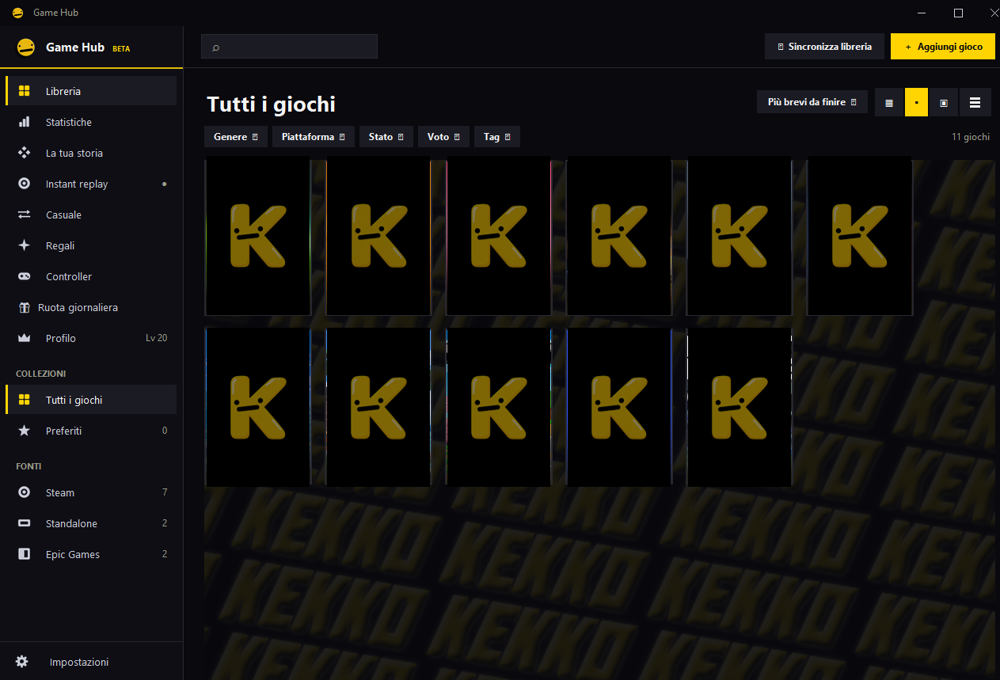
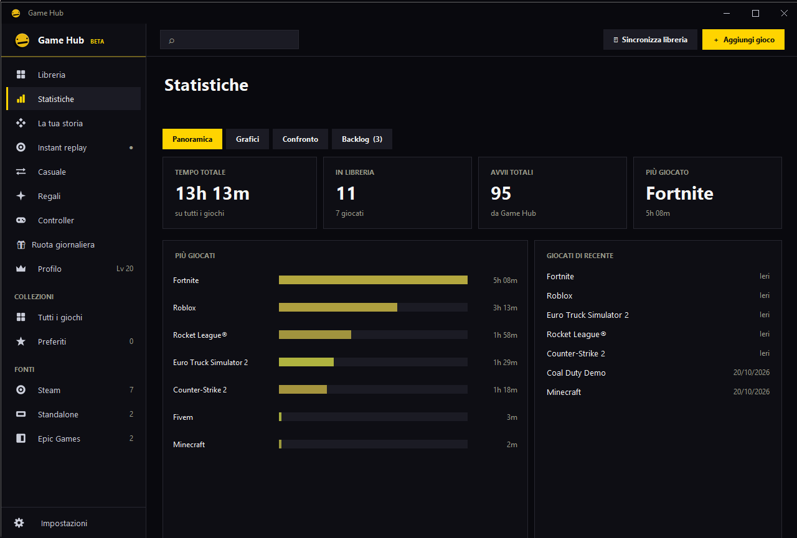
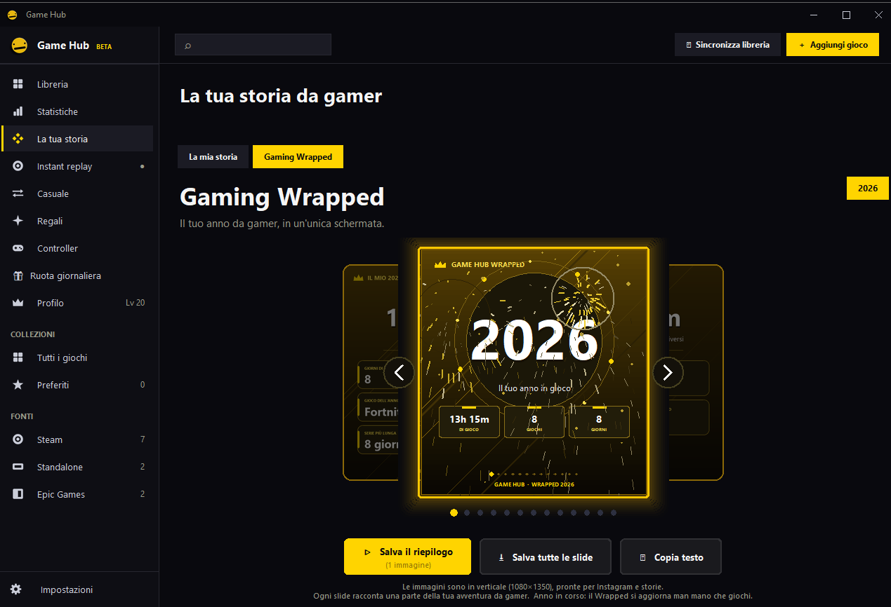
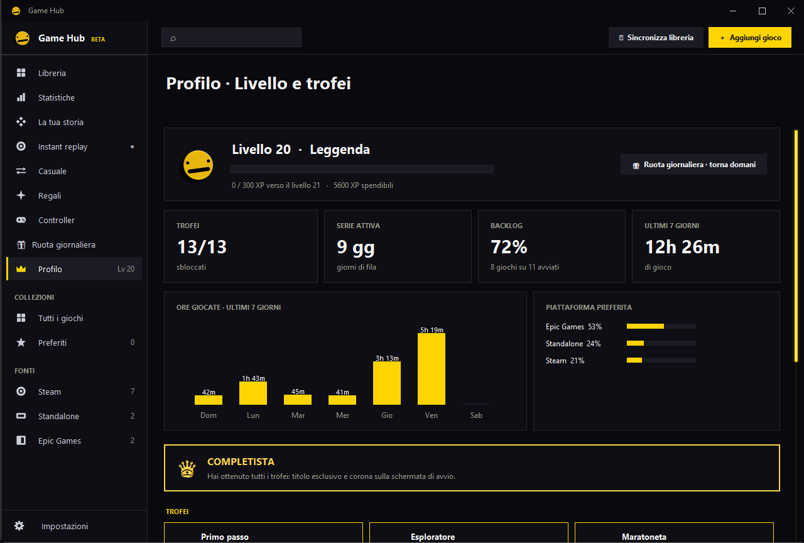
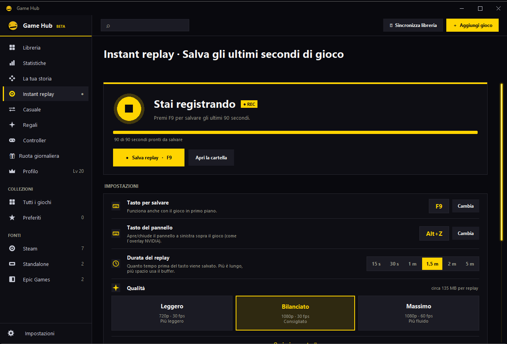
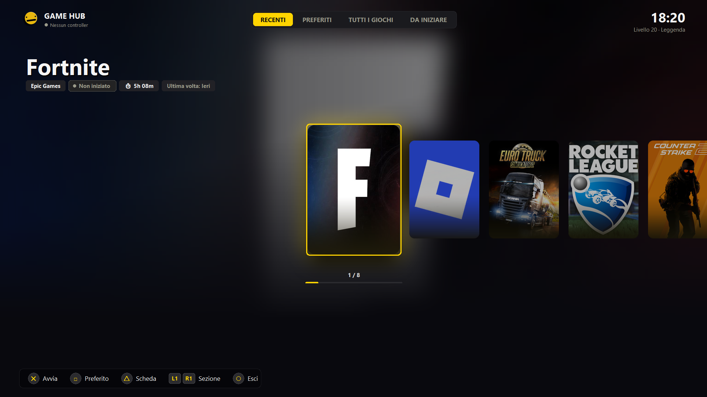
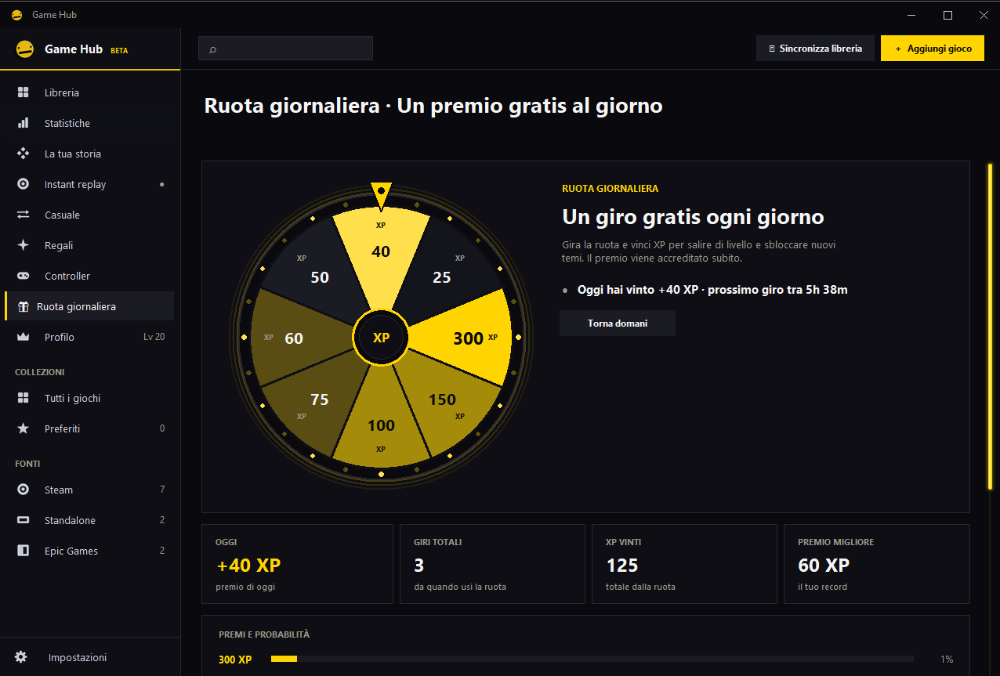
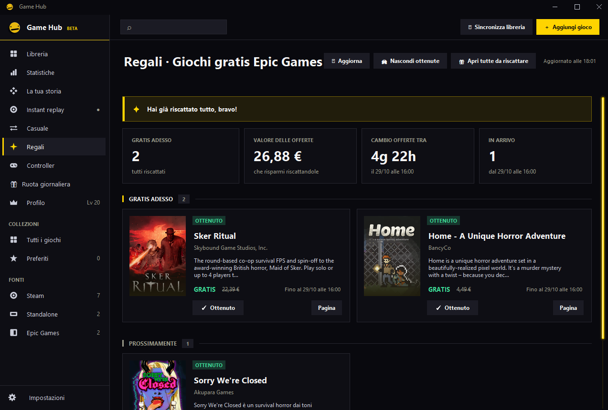
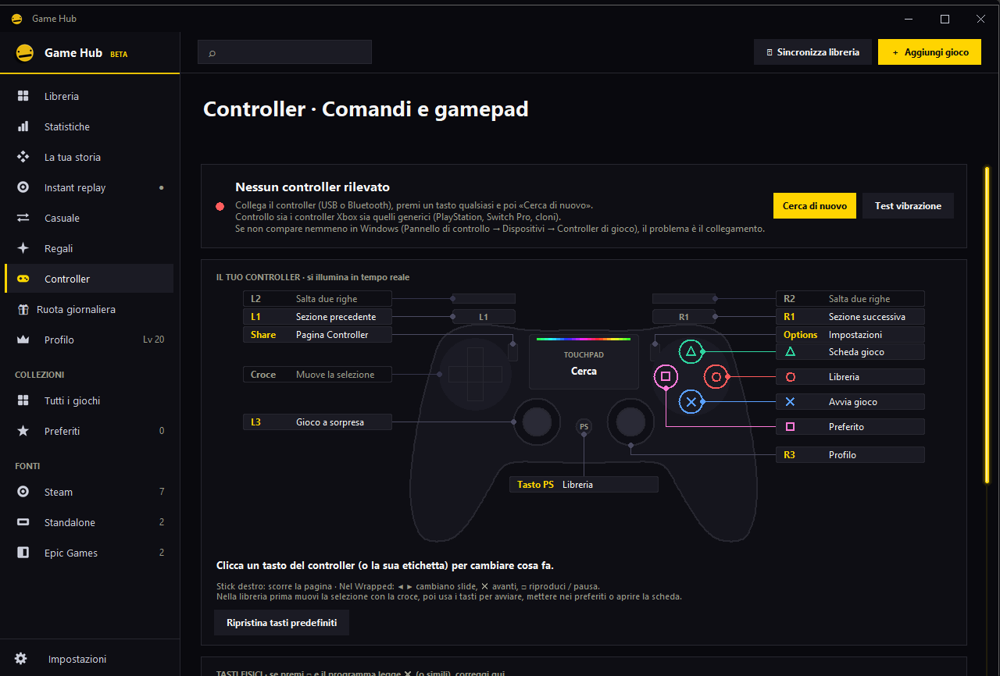
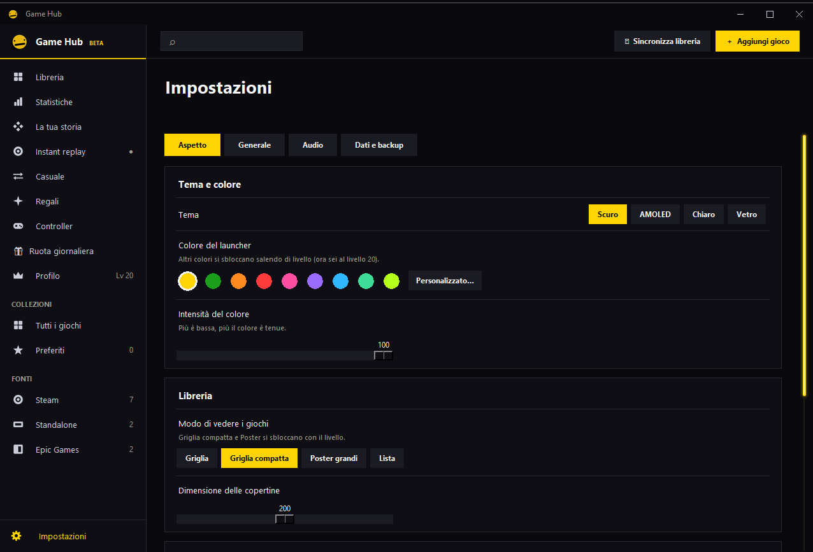

<div align="center">

# 🎮 Game Hub

**Il tuo launcher personale: tutti i giochi in un unico posto, con statistiche, livelli, instant replay e controller.**




</div>

---

## ✨ Cos'è Game Hub

Game Hub raccoglie i tuoi giochi e programmi (Steam, Epic Games, Xbox, Ubisoft e qualsiasi `.exe`) in un'unica interfaccia scura e moderna, con pulsanti di avvio, copertine, collezioni e tempo di gioco tracciato in automatico.

Tutti i dati restano **sul tuo PC**: nessun account, nessun invio online.

---

## 📸 Anteprima

| Libreria | Statistiche |
|:---:|:---:|
|  |  |

| Gaming Wrapped | Profilo e livelli |
|:---:|:---:|
|  |  |

| Instant replay | Big Picture |
|:---:|:---:|
|  |  |

| Ruota giornaliera | Regali Epic Games |
|:---:|:---:|
|  |  |

| Controller | Impostazioni |
|:---:|:---:|
|  |  |

---

## 🚀 Funzioni principali

### 📚 Libreria
- **Sincronizzazione automatica** dei giochi installati con Steam ed Epic Games
- Aggiungi qualsiasi gioco o programma: `.exe`, collegamento o link (`steam://...`)
- **Copertine** scaricate da Steam, con carte che si girano (retro con il logo)
- Viste: griglia, griglia compatta, poster grandi e lista
- Collezioni, preferiti, **tag personalizzati**, ricerca e ordinamento
- Filtri per genere, piattaforma, stato e voto
- Scheda del gioco con **voto, note private, recensione, stato** (in corso, completato, abbandonato) e durata stimata

### 📊 Statistiche e storia
- Tempo di gioco tracciato in automatico (anche se avvii il gioco fuori da Game Hub)
- Grafici per giorno, settimana e mese, confronto tra periodi
- Giochi più giocati, gioco del mese e dell'anno
- **Backlog**: giochi mai avviati, con previsione di quando lo finirai
- **Consigli**: cosa giocare dopo, analisi dei generi preferiti, riepilogo mensile
- **Gaming Wrapped**: il riepilogo del tuo anno in slide animate, esportabile come immagini 1080×1350 per i social

### 🏆 Livelli, trofei e ruota giornaliera
- Guadagni **XP** giocando e sali di livello
- Trofei da sbloccare e titoli da scegliere
- Ogni livello sblocca temi, colori, cornici animate, particelle, transizioni e widget
- **Ruota giornaliera** gratis: un premio in XP ogni giorno

### 🎥 Instant replay
- Salva in un attimo gli **ultimi secondi di gioco**, come un replay istantaneo
- Tasto globale (funziona anche con il gioco in primo piano) e **pannello overlay** a sinistra
- Audio migliorato e **antirumore** del microfono
- Qualità, risoluzione e fps regolabili; supporto a più monitor
- Galleria dei replay con anteprime

### 🎁 Regali e wishlist
- **Giochi gratis di Epic Games** con conto alla rovescia e avvisi
- **Wishlist Steam** con avvisi automatici su sconti e demo

### 🕹 Controller e Big Picture
- Naviga con il gamepad (Xbox, PlayStation, Switch Pro e generici)
- Tasti riassegnabili e vibrazione
- Modalità **Big Picture** a schermo intero, pensata per il divano

### 🎚 Audio e integrazioni
- **Mixer volume** con livelli in tempo reale (gioco, Discord, browser…)
- **Discord Rich Presence** con cronometro della sessione
- Icona nell'area di notifica (tray)
- 4 temi (Scuro, AMOLED, Chiaro, Vetro), italiano e inglese
- Aggiornamenti automatici da GitHub

---

## 📦 Installazione

1. Vai alla pagina delle [**Release**](https://github.com/K3KK09/Khub-game.hub/releases/latest)
2. Scarica `Khub.exe`
3. Avvialo con un doppio clic

Non serve installare nient'altro. Per l'**instant replay** serve `ffmpeg`: Game Hub può scaricarlo e configurarlo da solo con un clic dalla pagina *Instant replay*.

---

## 🧭 Guida rapida

1. Premi **⟳ Sincronizza libreria** per importare Steam ed Epic
2. Oppure **＋ Aggiungi gioco** per inserirne uno a mano
3. Clic su una carta (o ▶) per avviare il gioco
4. **Tasto destro** su un gioco: modifica, preferito, stato, voto, collezioni, tag, rimuovi
5. Il tempo di gioco si registra da solo: guarda la pagina **Statistiche**

Al primo avvio parte un **tutorial** guidato; puoi rivederlo da *Impostazioni → Generale → Aiuto*.

---

## 🎹 Scorciatoie

| Tasto | Azione |
|---|---|
| `F9` | Salva instant replay *(modificabile)* |
| `Alt + Z` | Apri/chiudi il pannello overlay *(modificabile)* |
| `F11` | Apri Big Picture |

---

## 💾 Dove sono i miei dati

I dati si trovano in una cartella fissa, indipendente da dove tieni il programma:

```
%APPDATA%\GameHub\
├── game_hub_data.json   ← giochi, statistiche, impostazioni
├── covers\              ← copertine
├── backups\             ← backup automatici (ultimi 30)
└── assets\              ← sfondi personalizzati
```

Da *Impostazioni → Dati e backup* puoi creare un backup, ripristinarne uno e azzerare le statistiche.

---

## 🔄 Aggiornamenti

Game Hub controlla da solo se c'è una nuova versione su GitHub. I tuoi giochi, i tempi di gioco e le impostazioni **non vengono mai toccati** dall'aggiornamento.

---

## 🔒 Privacy

- Nessun account, nessuna registrazione, nessuna telemetria
- Note, recensioni e statistiche restano nel file dati sul tuo PC
- Le uniche connessioni sono quelle necessarie a copertine, prezzi Steam, giochi gratis Epic e aggiornamenti

---

## ⚖️ Licenza

Game Hub **non è open source**. Tutti i diritti sono riservati: il programma è gratuito da usare, ma non è consentito copiare, modificare, ridistribuire o rivendere il codice o l'eseguibile senza il permesso dell'autore.

---

<div align="center">

Fatto con ❤️ da **K3KK09**

</div>
